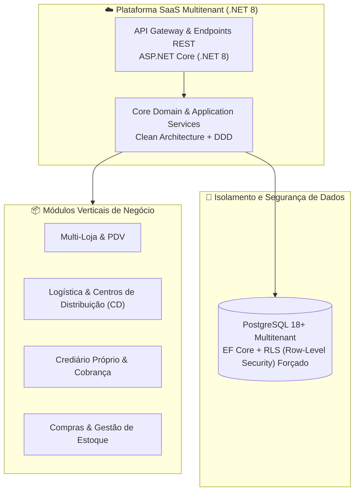

# 🏢 Alvo7 App & Besides — Soluções ERP & SaaS Corporativo

Bem-vindo ao hub de engenharia e arquitetura de software da parceria **Alvo7 App & Besides**. Esta organização é dedicada ao desenvolvimento de produtos SaaS de missão crítica para gestão empresarial de alta escala.

---

## 🏛️ Visão Arquitetural do Ecossistema

---

## 📦 Repositórios

### 🛒 [erp-varejo](https://github.com/alvo7app-besides/erp-varejo)
- **Função:** Plataforma ERP SaaS multitenant para redes de varejo de departamentos (móveis, eletrodomésticos, eletrônicos), contemplando logística de distribuição, crediário próprio e controle centralizado multi-loja.
- **Stack:** Backend em **.NET 8 (C#)**, Entity Framework Core, PostgreSQL com isolamento rigoroso via Row-Level Security (RLS) e testes automatizados (`dotnet test backend/Erp.sln`).
- **Status:** Em desenvolvimento ativo de arquitetura e fundação.

---

## 🚀 Padrões de Engenharia

- **Branch Base:** `main`. O fluxo de desenvolvimento utiliza branches específicas e validação via testes de integração e unidade.
- **Segurança & Compliance:** RLS mandatário para garantir segregação absoluta entre tenants; zero credenciais ou connection strings expostas no código-fonte.
- **Commits:** Padronização com [Conventional Commits](https://www.conventionalcommits.org/).
